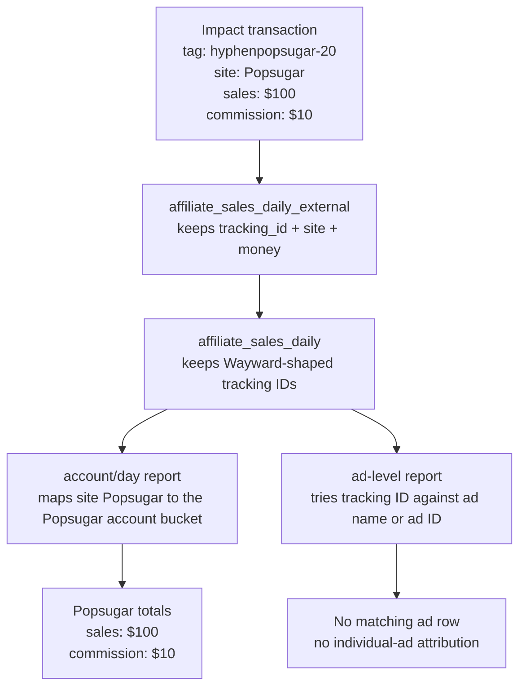

# WAY-2234: How old reporting assigns no-ad-ID revenue to an account

Status: **explanation only; untracked review draft**

This walkthrough answers one narrow question about the old reporting flow:

> If an affiliate transaction has no Meta ad ID, how can the old report still
> associate it with an account?

The short answer is: **through its publisher/site label, not through an ad**.

Those are different claims:

```text
"This is Popsugar revenue"       publisher/account-level association
"Meta ad 123 caused this sale"   ad-level attribution
```

The old flow can make the first claim without being able to make the second.

## Concrete example

Assume Impact reports this transaction:

```text
tracking_id = hyphenpopsugar-20
site        = Popsugar
sales       = $100
commission  = $10
Meta ad ID  = absent
```

The values serve different purposes:

| Value | What the old flow learns from it |
| --- | --- |
| `hyphenpopsugar-20` | The row is Wayward-related and should remain in affiliate reporting. |
| `Popsugar` | The publisher/site bucket that owns the affiliate activity. |
| Meta ad ID absent | No stable individual ad has been identified. |

The old flow therefore retains `$100` of sales and `$10` of commission under
Popsugar, but it does not prove that any particular Meta ad generated them.

## The old flow, step by step



### 1. Impact supplies a tracking tag and a site

The Impact arm of
[`affiliate_sales_daily_external.sql`](../devops/data/queries/canonical/affiliate_sales_daily_external.sql)
copies Impact's `site`, selects a publisher sub-ID as `tracking_id`, and retains
the sale and payout.

The important point is that `site` and `tracking_id` are separate columns. The
pipeline does not need to extract a Meta ad ID from `hyphenpopsugar-20` in order
to retain the row as Popsugar affiliate activity.

For non-Amazon sources, that view also tries several historical mappings from
the tracking ID to a site and falls back to the source-provided site. It then
normalizes site spellings before aggregating by site, date, and tracking ID.

Conceptually:

```text
tracking_id mappings, if available
              ↓
Impact site = Popsugar ──fallback──> final site = Popsugar
```

This is publisher/site resolution. It is not ad resolution.

### 2. The Wayward-shaped tag keeps the row in canonical revenue

[`affiliate_sales_daily.sql`](../devops/data/queries/canonical/affiliate_sales_daily.sql)
keeps rows whose tracking IDs have recognized Wayward-era prefixes, including
`hyphen%`.

Therefore `hyphenpopsugar-20` passes the filter. The filter establishes that the
transaction belongs in Wayward's affiliate reporting population; it does not
establish which ad caused the transaction.

After this step, the simplified row is still:

```text
site        = Popsugar
tracking_id = hyphenpopsugar-20
sales       = $100
commission  = $10
```

### 3. The account/day report groups revenue by site independently of ads

[`ad_spend_and_affiliate_revenue_daily.sql`](../devops/data/queries/canonical/ad_spend_and_affiliate_revenue_daily.sql)
aggregates affiliate revenue by retailer, site, and date. It separately
aggregates spend by site and date, then combines the two sides with a
`FULL OUTER JOIN`.

That full join is why revenue survives even when there is no matching spend or
ad row:

```text
Popsugar revenue on August 26       Popsugar spend on August 26
             \                         /
              FULL OUTER JOIN by site/date
                          |
                          v
                  Popsugar account/day row
```

The view also joins the site label to `adservice.account.site` to obtain the
corresponding account-name-shaped reporting bucket. This is a display-name/site
mapping, not stable ad identity.

For the example, the old account/day result is effectively:

| Date | Site/account bucket | Spend | Sales | Commission |
| --- | --- | ---: | ---: | ---: |
| Example day | Popsugar | possibly `$0` | `$100` | `$10` |

The row can exist with zero spend because the revenue side is independently
preserved by the full join.

### 4. The old ad-level report cannot assign this example to an ad

The old ad-level view,
[`ad_spend_and_affiliate_revenue_by_ad_by_date.sql`](../devops/data/queries/canonical/ad_spend_and_affiliate_revenue_by_ad_by_date.sql),
requires the revenue token to equal either:

```text
spend.ad_name
or
spend.ext_ad_id
```

It also requires the date and account-shaped site mapping to agree. The account
condition only narrows candidate ads; it does not create an ad match.

For `hyphenpopsugar-20`, production investigation found no matching historical
ad name, and the value is not a Meta ad ID. Therefore:

```text
known publisher/account = Popsugar
known ad                = none
```

The `$100` remains visible in the old account/day revenue report, but it does
not appear as revenue for a specific ad in the old ad-level report.

## Why knowing the account is insufficient

An account can have many ads:

```text
Popsugar account
├── Meta ad 123
├── Meta ad 456
└── organic or historical publisher traffic
```

Knowing that a sale belongs to Popsugar does not tell us which branch caused
it. Assigning the entire `$100` to ad 123 would be invented attribution. Dividing
it between ads 123 and 456 would be an estimate, not proof.

This is why the ID-first design separates:

1. **Publisher/account association:** retain the transaction for Popsugar and
   source reconciliation.
2. **Ad attribution:** leave `ext_ad_id` NULL unless direct, session, or unique
   historical alias evidence identifies one ad.

For this example, the faithful new representation would be approximately:

```text
publisher_account = Popsugar
ext_ad_id          = NULL
attribution_status = unproved
reason             = publisher_or_account_tag
sales              = $100
commission         = $10
```

That does not lose the affiliate transaction. It preserves exactly what the old
flow actually knew while avoiding the stronger, unsupported claim that the
transaction came from a particular Boost ad.

## One-sentence takeaway

The old flow ties `hyphenpopsugar-20` revenue to Popsugar through the affiliate
row's **site/account mapping**, while its separate **ad-name-or-ad-ID join** finds
no individual ad; account ownership and ad attribution are not the same thing.